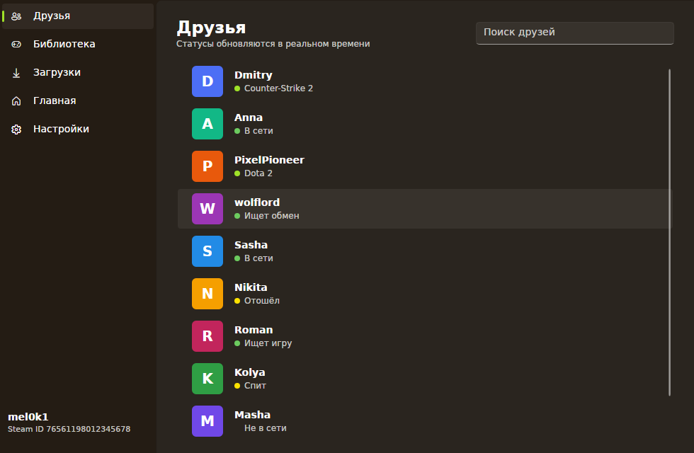
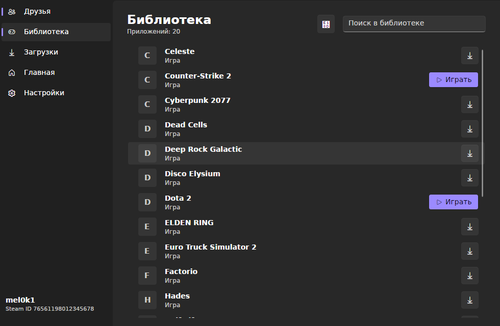

# Miseria

[](https://github.com/mel0k1/Miseria/actions/workflows/build.yml)
[](LICENSE)
[](https://dotnet.microsoft.com)

A minimal Steam client built on [SteamKit2](https://github.com/SteamRE/SteamKit) with an [Avalonia](https://github.com/AvaloniaUI/Avalonia) UI styled by [FluentAvalonia](https://github.com/amwx/FluentAvalonia). Cross-platform, no WebView, no Steam client installation required.

## Status

Early development. What works now:

- Password logon through the SteamKit2 authentication API
- Steam Guard prompts (email code, authenticator code) shown in the logon window
- Friends list with live presence: online, away, snooze, looking to trade or play, in-game with the game name, avatars cached on disk
- Library of owned apps: licenses are resolved to app ids through PICS product info, names, types and icons are shown with search
- Library grid view: capsule artwork straight from the Steam CDN with a disk cache, switchable between the compact list and a Steam-style capsule grid
- Downloads through SteamContent: depots are resolved from app info, manifests and depot keys are fetched, chunks are downloaded from the Steam CDN in parallel, decrypted and verified, with progress, speed and cancel
- Branch picker for downloads: every depot branch is listed with its build id, password-protected beta branches unlock through the private beta PICS request
- Family View awareness: locked accounts are detected at logon and the session can be unlocked with the Family View PIN through Steam's Parental service
- Install tracking and game launch: finished downloads are registered as installed apps and get a Play button that starts the executable from the app's launch config (Wine is used automatically for Windows games on Linux)
- Manifest-diff updates: every install records its depot manifests, a check compares them with the current manifests on Steam and an update redownloads only the files whose hashes changed and deletes removed files
- Automatic re-logon between launches: the refresh token is saved and reused, no password prompt until the session expires
- Session status and logoff (logoff deletes the stored session)
- Four themes: Light, Dark, Crimson and Kiwi
- Theme selection persisted to disk
- Home dashboard: account card, apps count, installed games, friends and friends online
- Navigation pane footer with the account name and Steam id

The first logon on a new device may ask for a Steam Guard code. The refresh token and guard data are stored unencrypted in `~/.config/Miseria/session.json` (`%APPDATA%\Miseria` on Windows) with file permissions limited to the current user on Linux and macOS. Deleting the file or logging out forces the password prompt again.

## Screenshots

| Logon (Light) | Logon (Kiwi) |
| --- | --- |
|  |  |

| Friends (Dark) | Friends (Kiwi) |
| --- | --- |
|  |  |

| Library grid (Dark) | Library list (Dark) |
| --- | --- |
|  |  |

| Downloads (Dark) | Home (Dark) |
| --- | --- |
|  |  |

## Build

Requires the .NET 10 SDK.

```
git clone https://github.com/mel0k1/Miseria.git
cd Miseria
dotnet run --project src/Miseria.App
```

The screenshots in `docs/screenshots` are regenerated headlessly with Xvfb:

```
xvfb-run -a dotnet run --project tools/Screenshots -- docs/screenshots
```

## Themes

| Theme | Background | Accent |
| --- | --- | --- |
| Light | stock Fluent light | stock |
| Dark | stock Fluent dark | stock |
| Crimson | near-black `#150B0D` | red `#E81123` |
| Kiwi | warm dark brown `#241C14` | kiwi green `#7CB518` |

The Kiwi palette borrows from both the fruit (green accent) and the bird (brown background). Custom palettes override the Fluent color resources on top of the dark variant, so every FluentAvalonia control picks them up without custom styles.

## Project layout

```
Miseria.slnx
src/Miseria.Core    SteamKit2 session: connect, authenticate, guard prompts, friends feed, library feed, CDN downloads, logoff
src/Miseria.App     Avalonia UI: MVVM view models, FluentAvalonia shell, theming
```

`Miseria.Core` is the only place that touches SteamKit2 types. The UI talks to it through plain events and records: `LogOnAsync`, `GuardRequested`, `LoggedIn`, `LogonFailed`, `LoggedOut`, `FriendsLoaded`, `FriendUpdated`, `LibraryLoaded`, `SteamDownloader` with `GetBranchesAsync` / `DownloadAsync` / `CheckUpdateAsync`, the `Started`, `Progress`, `Finished` events and the `ManifestRecord` / `UpdateCheck` records, and `UnlockFamilyViewAsync` for the Family View PIN.

Downloads are written to `~/Miseria/games/<appid>`, resumed by file size when restarted and registered in `%APPDATA%\Miseria\installs.json`, which drives the Play buttons in the library. Every install also writes `%APPDATA%\Miseria\manifests\appmanifest_<appid>.json` with the depot manifest ids and per-file hashes; the updates tab diffs it against Steam on request and only replaces files whose hash actually changed.

## Roadmap

The long-term goal is a central hub client like Steam itself. Planned next:

- Profile: own avatar, persona name, level, country and Steam id on the home page
- Chat: friend messaging through SteamKit2 unified messages
- Marketplace: market listings, price history and buy/sell orders through the Steam Web API (SteamKit2 has no market handler, so this goes over the web endpoints)
- Trading platform: trade offers with inventory browsing through the Steam Web API
- Community: profiles, groups and activity feed

## Notes

Miseria is not affiliated with Valve. Steam is a trademark of Valve Corporation.

Runtime dependencies: [SteamKit2](https://www.nuget.org/packages/SteamKit2) (LGPL-2.1-only), [FluentAvaloniaUI](https://www.nuget.org/packages/FluentAvaloniaUI) and [Avalonia](https://www.nuget.org/packages/Avalonia) (MIT).

## License

GPL-3.0. See [LICENSE](LICENSE).
