# Miseria

[](https://github.com/mel0k1/Miseria/actions/workflows/build.yml)
[](LICENSE)
[](https://dotnet.microsoft.com)

A minimal Steam client built on [SteamKit2](https://github.com/SteamRE/SteamKit) with an [Avalonia](https://github.com/AvaloniaUI/Avalonia) UI styled by [FluentAvalonia](https://github.com/amwx/FluentAvalonia). Cross-platform, no WebView, no Steam client installation required.

## Status

- Password logon with Steam Guard prompts, refresh token saved between launches for automatic re-logon
- Friends list with live presence, avatars and disk-cached images
- Friend chat: messages, typing indicator, unread badges and server-side history
- Profile page: avatar, persona name, status, country, summary, member since and Steam id
- Marketplace through the Steam Web API: item search with app and currency filters, price overview (lowest, median, daily volume) and personal sell listings with buy orders that can be cancelled
- Inventory browser: items per app and context with icons, tradable and marketable badges, descriptions and price overview for each item
- Selling from the inventory: list an item on the market for a buyer price without leaving the app
- Trade offers through IEconService with item tiles from both sides, accept, decline and cancel through steamcommunity
- Trade offer creation: pick a friend, select items from your inventory and the friend's inventory on both sides, attach a message and send the offer
- Workshop: search and browse materials per app with previews, statistics and tags, subscribe and unsubscribe through steamcommunity
- Groups: your groups with avatars and member counts, group lookup by short name or link, join and leave
- Community page: game news for owned apps and featured store items (specials, top sellers, new releases)
- Library of owned apps through PICS with names, types, icons, search, list and Steam-style capsule grid
- Downloads through SteamContent: parallel chunk download from the Steam CDN with decryption, verification, progress and cancel
- Branch picker for depot branches, password-protected betas unlock through the private beta PICS request
- Family View detection at logon and PIN unlock through Steam's Parental service
- Install tracking, Play button (Wine for Windows games on Linux) and manifest-diff updates that redownload only changed files
- Four themes: Light, Dark, Crimson, Kiwi, persisted to disk
- Home dashboard with an account card and counters

The refresh token and guard data are stored unencrypted in `~/.config/Miseria/session.json` (`%APPDATA%\Miseria` on Windows) with user-only file permissions on Linux and macOS. Deleting the file forces the password prompt again.

## Screenshots

| Friends (Dark) | Chat (Dark) |
| --- | --- |
| 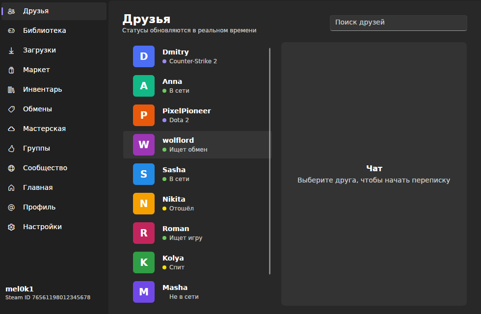 | 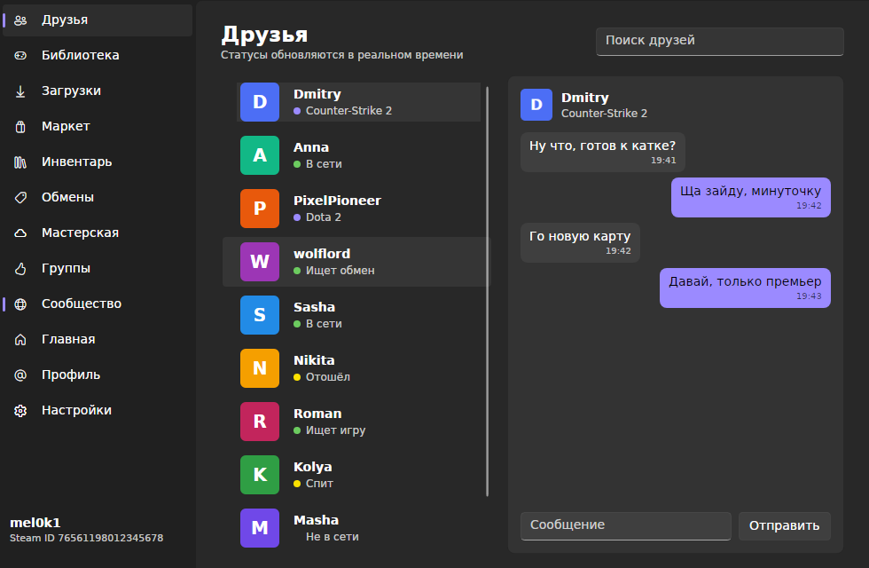 |

| Library grid (Dark) | Downloads (Dark) |
| --- | --- |
| 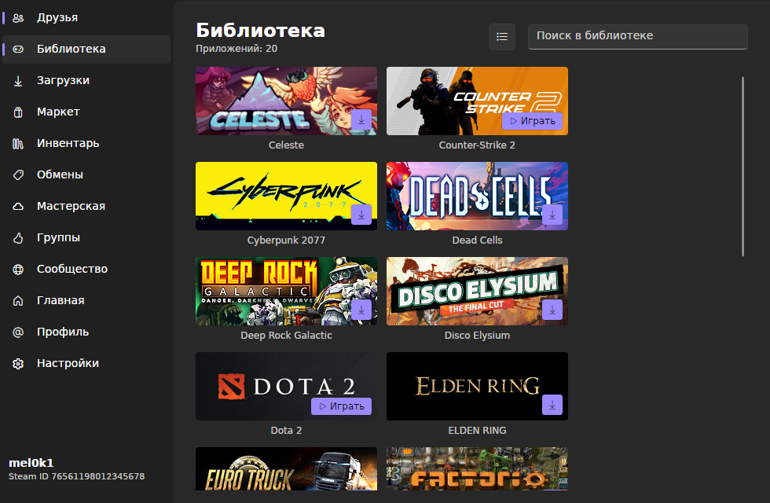 | 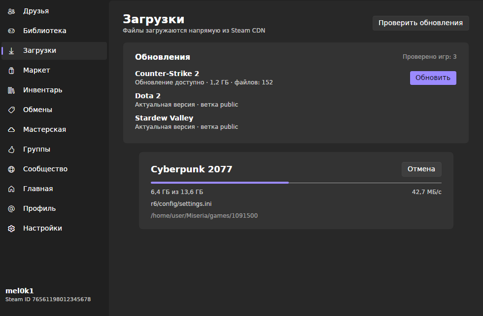 |

| Profile (Dark) | Home (Dark) |
| --- | --- |
| 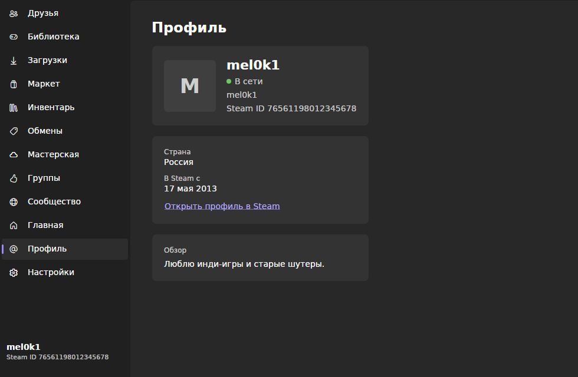 | 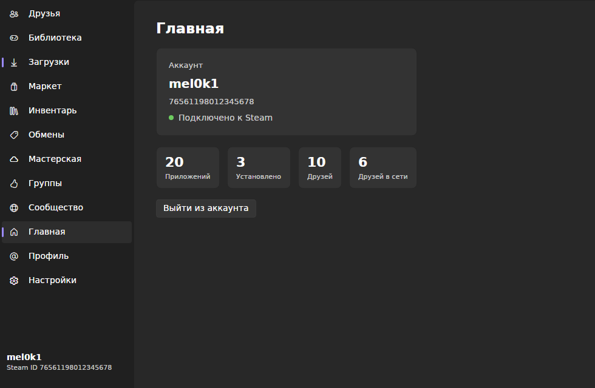 |

| Market (Dark) | Trade offers (Dark) |
| --- | --- |
| 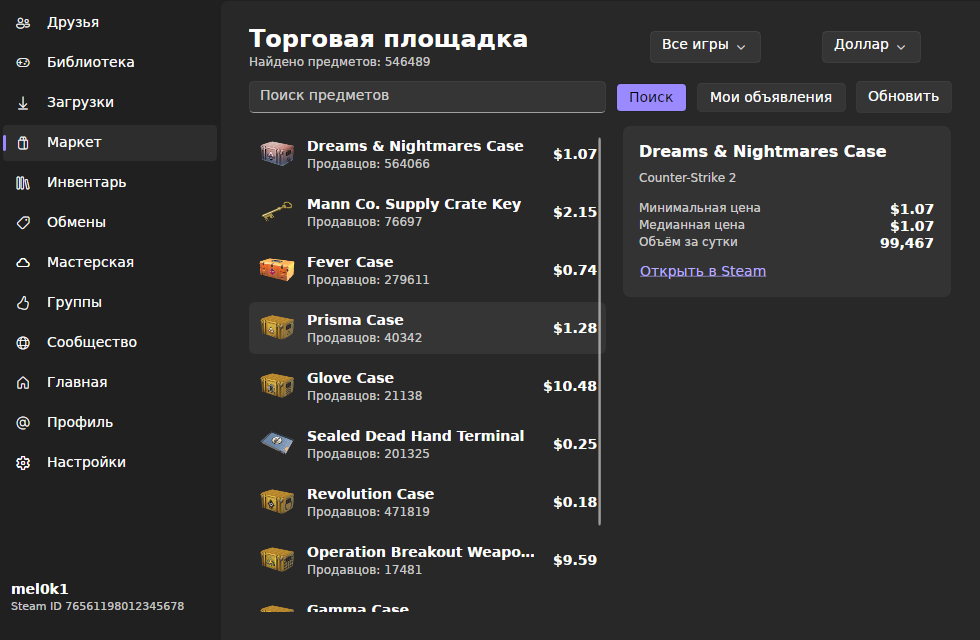 | 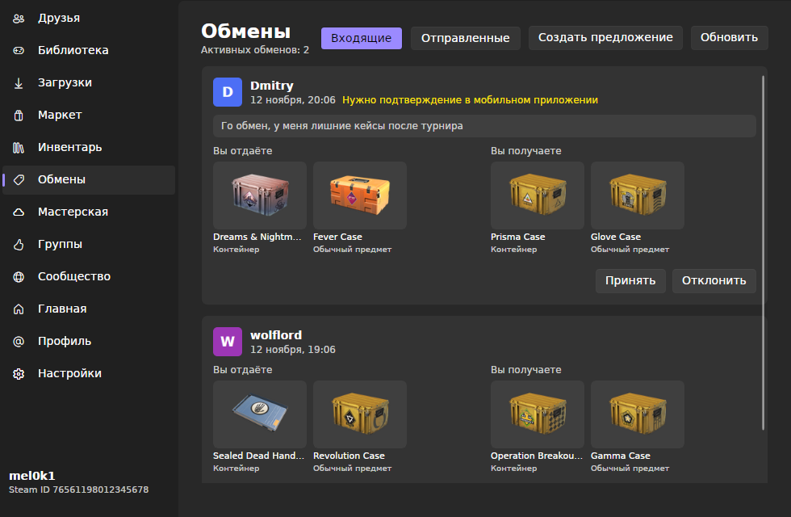 |

| Inventory (Dark) | Trade creation (Dark) |
| --- | --- |
| 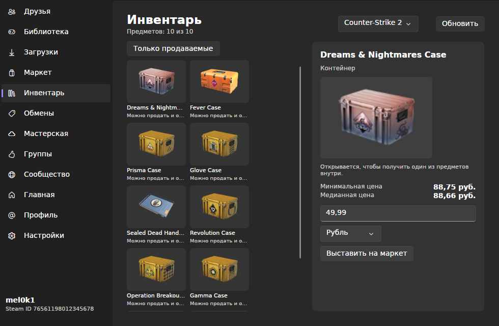 | 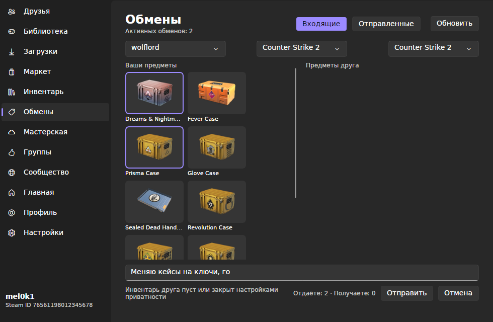 |

| Workshop (Dark) | Groups (Dark) |
| --- | --- |
| 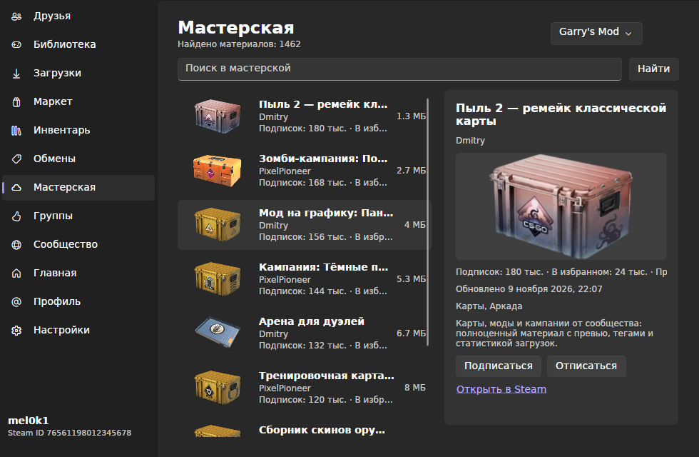 | 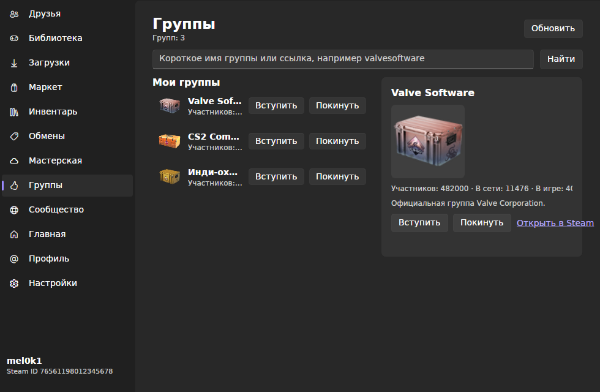 |

| Community (Dark) | |
| --- | --- |
| 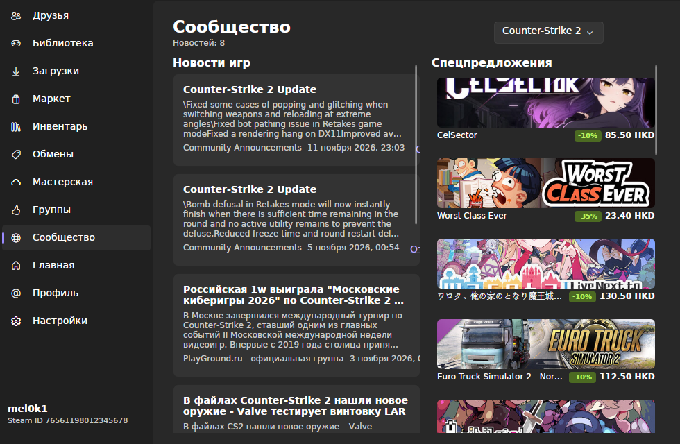 | |

## Build

Requires the .NET 10 SDK.

```
git clone https://github.com/mel0k1/Miseria.git
cd Miseria
dotnet run --project src/Miseria.App
```

The screenshots in `docs/screenshots` are regenerated headlessly with Xvfb:

```
xvfb-run -a dotnet run --project tools/Screenshots -- docs/screenshots
```

## Roadmap

The long-term goal is a central hub client like Steam itself. Planned next:

- Market buy orders creation
- Friends activity feed
- Group announcements and discussions

## License

GPL-3.0. See [LICENSE](LICENSE). Not affiliated with Valve; Steam is a trademark of Valve Corporation. Runtime dependencies: [SteamKit2](https://www.nuget.org/packages/SteamKit2) (LGPL-2.1-only), [FluentAvaloniaUI](https://www.nuget.org/packages/FluentAvaloniaUI) and [Avalonia](https://www.nuget.org/packages/Avalonia) (MIT).
