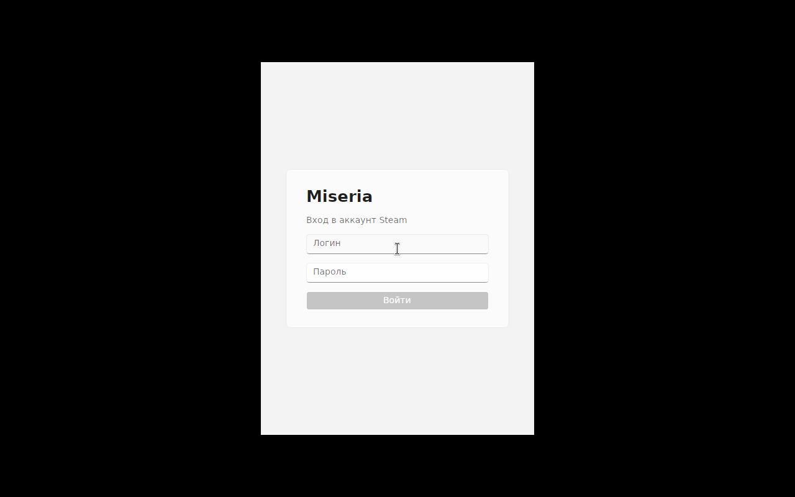
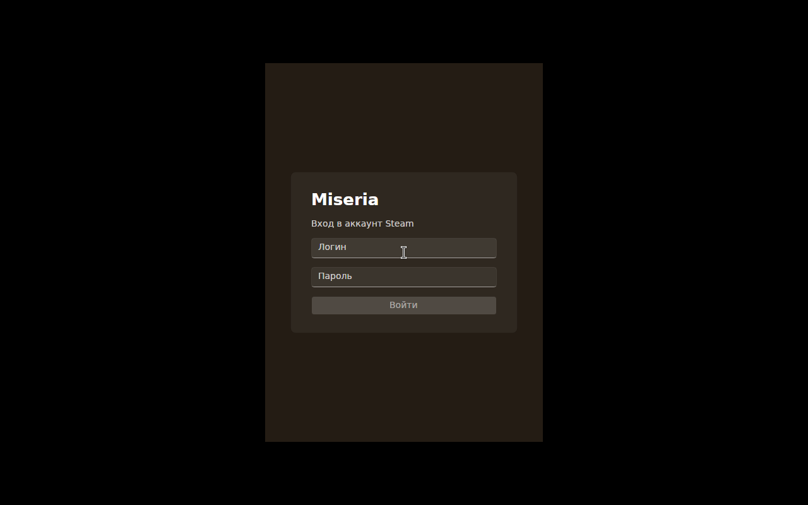

# Miseria

[](https://github.com/mel0k1/Miseria/actions/workflows/build.yml)
[](LICENSE)
[](https://dotnet.microsoft.com)

A minimal Steam client built on [SteamKit2](https://github.com/SteamRE/SteamKit) with an [Avalonia](https://github.com/AvaloniaUI/Avalonia) UI styled by [FluentAvalonia](https://github.com/amwx/FluentAvalonia). Cross-platform, no WebView, no Steam client installation required.

## Status

Early development. What works now:

- Password logon through the SteamKit2 authentication API
- Steam Guard prompts (email code, authenticator code) shown in the logon window
- Session status and logoff
- Four themes: Light, Dark, Crimson and Kiwi
- Theme selection persisted to disk

The first logon on a new device may ask for a Steam Guard code. Subsequent logons reuse the stored guard data for the current session.

## Screenshots

| Light | Kiwi |
| --- | --- |
|  |  |

## Build

Requires the .NET 10 SDK.

```
git clone https://github.com/mel0k1/Miseria.git
cd Miseria
dotnet run --project src/Miseria.App
```

## Themes

| Theme | Background | Accent |
| --- | --- | --- |
| Light | stock Fluent light | stock |
| Dark | stock Fluent dark | stock |
| Crimson | near-black `#150B0D` | red `#E81123` |
| Kiwi | warm dark brown `#241C14` | kiwi green `#7CB518` |

The Kiwi palette borrows from both the fruit (green accent) and the bird (brown background). Custom palettes override the Fluent color resources on top of the dark variant, so every FluentAvalonia control picks them up without custom styles.

## Project layout

```
Miseria.slnx
src/Miseria.Core    SteamKit2 session: connect, authenticate, guard prompts, logoff
src/Miseria.App     Avalonia UI: MVVM view models, FluentAvalonia shell, theming
```

`Miseria.Core` is the only place that touches SteamKit2 types. The UI talks to it through plain events and records: `LogOnAsync`, `GuardRequested`, `LoggedIn`, `LogonFailed`, `LoggedOut`.

## Roadmap

- Friends list with live statuses
- Owned apps and packages through licenses and PICS
- Downloads via SteamContent
- Session persistence with refresh tokens
- Family View awareness

## Notes

Miseria is not affiliated with Valve. Steam is a trademark of Valve Corporation.

Runtime dependencies: [SteamKit2](https://www.nuget.org/packages/SteamKit2) (LGPL-2.1-only), [FluentAvaloniaUI](https://www.nuget.org/packages/FluentAvaloniaUI) and [Avalonia](https://www.nuget.org/packages/Avalonia) (MIT).

## License

GPL-3.0. See [LICENSE](LICENSE).
